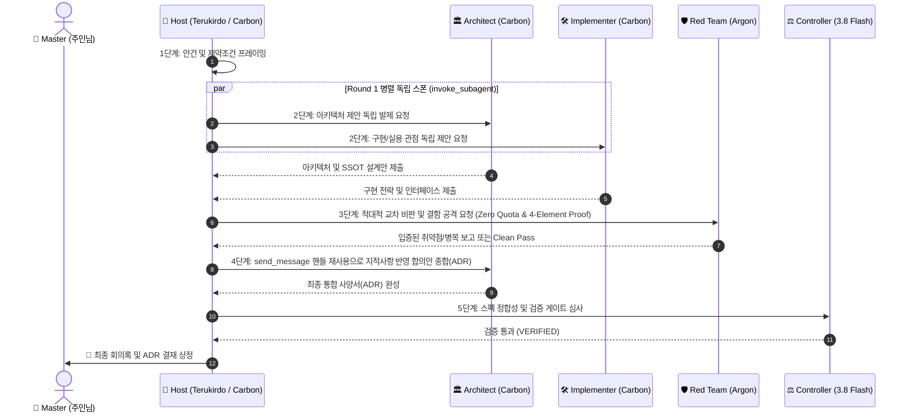

# Multi-Agent Conference & Roundtable (다자간 에이전트 원탁회의)

복잡한 시스템 설계, 프론트-백엔드 간 인터페이스 합의, 보안 및 성능 트레이드오프 분석 등 단일 모델의 판단만으로 불확실성이 큰 의사결정을 해결하기 위해 **특화된 복수 모델 페르소나 간의 구조화된 원탁회의(Roundtable Conference)**를 주재하고 합의된 아키텍처 결정서(ADR) 및 사양서를 도출하는 스킬이다.

---

## 1. Use When (발동 조건)

- 2개 이상의 아키텍처/기술적 대안 사이에서 명확한 트레이드오프 분석이 필요할 때.
- UI/UX, 백엔드 데이터 엔진, 보안 경계가 얽힌 대규모 기능의 공동 설계가 필요할 때 (`UltimateMake` Phase 3 포함).
- 단일 모델의 인지 편향(Cognitive Bias)이나 맹점을 타파하기 위해 **적대적 레드팀 검증(Adversarial Red Teaming)**이 필요할 때.
- 사용자(주인님)가 다자간 회의, 브레인스토밍, 모델 간 토론을 명시적으로 요청했을 때.

---

## 2. Participant Personas & Role Matrix (v5.7 Gemini 4 Full-Spectrum 참여 모델 및 역할 체계)

회의는 문제의 성격에 따라 테르키르도 v5.7 비대칭 멀티 엔진(`Gemini 4 Carbon` / `Orchestrator [gemini-pro-orchestrator]` / `Gemini 4 Hydrogen [High/XHigh]` × `Gemini 4 Argon` × `Gemini 3.8 Flash`) 페르소나 중 2~5인을 선별하여 구성한다 (`inherit` 페르소나는 세션 모드에 따라 플래그십 `Gemini 4 Carbon`, 동적 하이브리드 `Orchestrator`, 또는 고속 프로토타이핑/구현용 `Gemini 4 Hydrogen (High/XHigh)`으로 구동됨).

| 역할 | 페르소나 모델 (Engine) | 주요 전문 영역 및 책임 |
| :--- | :--- | :--- |
| 👑 **주재관 (Host / Moderator)** | **테르키르도 (Terukirdo Orchestrator — Gemini 4 Carbon / Orchestrator / Hydrogen, `inherit`)** | 안건 상정, 발언권 조율, 논점 이탈 방지, 갈등 중재, 최종 합의안/ADR 종합 작성 |
| 🏛️ **수석 아키텍트 (Chief Architect)** | **Gemini 4 Carbon / Orchestrator (`inherit`)** | 거시적 시스템 구조, 도메인 경계, 인터페이스(SSOT), 데이터 흐름, ADR 초안 설계 |
| 🛠️ **실행/구현 엔지니어 (Surgical Implementer)** | **Gemini 4 Carbon / Gemini 4 Hydrogen (High/XHigh) (`inherit`)** | 코드 수준 구현 가능성, 고속 프로토타이핑 검증, 프로젝트 언어/아키텍처 관례 준수, 리팩터링 정밀도 |
| 🛡️ **적대적 심판관 / 보안·성능 레드팀 (Adversarial Red Team)** | **Gemini 4 Argon (`pro`)** | 침투 테스트 관점 공격, 보안 취약점, 경쟁 상태(Race Condition), 락프리 동시성·성능 병목 적발 |
| 🎨 **UX/UI & 접근성 리드 (UX/UI & Accessibility Lead)** | **Gemini 4 Carbon / Hydrogen / Argon** | 사용자 여정, 화면 흐름, 로딩/빈/에러 상태, 접근성(WCAG) 및 디자인 시스템 정합성 검토 |
| 🧪 **QA & 검증 전략가 (QA & Verification Strategist)** | **Gemini 4 Argon / Gemini 3.8 Flash** | Given-When-Then 인수조건, 회귀 테스트 경계, 엣지 케이스 검증 매트릭스 및 물리 게이트(`verify.ps1`, 단위 테스트) 설계 |
| ⚖️ **최종 관제 게이트키퍼 (Universal Controller)** | **Gemini 3.8 Flash (`flash`)** | 스펙 정합성, 빌드·테스트 게이트 및 규정 준수 신속 판정 |

---

## 3. Standard 5-Stage Conference Protocol (표준 5단계 회의 프로토콜)



### [Stage 1] 안건 및 제약조건 프레이밍 (Agenda Framing)
- 해결하고자 하는 문제의 본질, 성공 기준, 불변의 전제 조건(하네스 격리, 성능 목표, 프로토콜 v5.7 준수 등)을 명문화한다.
- 회의 참석 페르소나 및 배정 역할을 확정한다.

### [Stage 2] 도메인별 독립 제안 발제 (Round 1: Independent Proposals via Parallel `invoke_subagent`)
- Round 1 독립 발제는 `invoke_subagent` 병렬 스폰으로 수행하여 타 참가자의 발언에 끌려가는 앵커링 편향(Anchoring Bias)을 원천 차단한다.
- 각 전문가 페르소나는 자신의 전문 관점에서 최적의 설계·구현·UX·QA 제안서를 독립 제출한다.

### [Stage 3] 적대적 교차 비판 및 결함 공격 (Round 2: Cross-Critique & Red Teaming)
- 적대적 심판관(`Gemini 4 Argon`)이 제안서들의 보안 취약점, 경쟁 상태, 성능 병목, 도메인 경계 침범을 교차 검증한다.
- Round 2~3에서 기존 발제자에게 반론이나 보완을 요청할 때는 중복 서브에이전트를 새로 스폰하지 않고 기존 `conversationId`에 `send_message(Recipient=conv_id, Message=...)`를 호출하여 핸들과 컨텍스트를 재사용한다.

### [Stage 4] 갈등 중재 및 통합 합의안(ADR) 도출 (Round 3: Consensus & ADR Synthesis)
- 주재관(테르키르도) 및 수석 아키텍트(`send_message` 핸들 재사용)가 입증된 지적사항과 각 의견의 합리적 요소를 융합하여 갈등을 중재하고 단일 진실 공급원(SSOT) 아키텍처 결정서(ADR)를 작성한다.

### [Stage 5] 주인님 결재 상정 및 실행 위임 (Stage 5: Master Review & Actionable Handoff)
- 최종 회의록 및 ADR 문서를 아티팩트로 렌더링하여 주인님께 보고하고 명시적 승인을 구한다.
- **실행 이관 경로**:
  - **일반/단일 범위**: 표준 `Ralph Loop` (`implement-feature` / `agy-worker`)로 이관하여 구현 착수.
  - **대규모 비충돌 다중 모듈**: 주인님이 `/agent-legion` 슬래시 명령을 명시적으로 승인·발동할 경우 **Octa-Ralph(`MAX_CONCURRENT_RALPH = 8`)** 배타적 파티션 분해 및 `.agents/skills/agent-legion/scripts/legion_radio.py` 공용 무전 게시판 초기 `INTERFACE`/`SCHEMA` 규격 시딩으로 이관 가능하다.

---

## 4. Operating Rules & v5.7 Conference Contract (운영 원칙 및 v5.7 회의 규약)

1. **Anti-Echo Chamber (에코체임버 금지)**: 모든 주요 회의에는 반드시 최소 1개 이상의 적대적 비판자(Adversarial Red Team — `Gemini 4 Argon`) 역할을 필수 배치한다.
2. **Subagent Handle Reuse (`invoke_subagent` → `send_message`)**: Round 1 독립 발제는 `invoke_subagent` 병렬 스폰으로 앵커링 편향을 차단하고, Round 2~3 교차 반론·재심문 시에는 중복 서브에이전트 생성 없이 기존 `conversationId`에 `send_message(Recipient=conv_id, Message=...)`를 호출하여 핸들을 재사용한다.
3. **Zero Finding Quota & 4-Element Defect Contract (결함 할당량 없음 및 4요소 입증 계약)**: 적대적 레드팀 발언에는 의무적 결함 발굴 할당량이 없으며(Zero Finding Quota), 설계가 안전하고 완전하면 이를 인정하는 것이 성공이다. 설계 변경이나 블로킹 수정을 요구하는 중대 결함 제기 시에는 반드시 **(1) 위반된 계약/요구사항 + (2) 구체적 트리거 시나리오 + (3) 현재 코드/설계 근거 + (4) 실질적 피해/영향**의 4요소를 입증해야 한다.
4. **Evidence-Based Arguments (증거 기반 주장)**: 모든 찬반 의견은 막연한 주관이 아닌 구체적인 코드/설계 근거, 벤치마크 수치, 기술 스펙, 보안 표준을 근거로 제시해야 한다.
5. **Bounded Iteration (라운드 상한)**: 토론이 무한 루프에 빠지지 않도록 최대 3라운드 이내에 주재관이 합의안을 종합하며, 해결되지 않는 가치 판단은 주인님께 옵션별 득실로 에스컬레이션한다.
6. **Domain Boundary Preservation**: 회의 산출물은 반드시 개발 하네스(`.agents/`)와 대상 프로젝트 런타임 소스 코드 간의 도메인 경계를 엄격히 준수해야 한다.
7. **Master Sovereignty (주인님 주권)**: 최종 설계 확정 및 아키텍처 변경 권한은 오직 주인님의 승인에 귀속된다.

---

## 5. Output Artifacts (산출물 형식)

회의 종료 시 다음 구조의 마크다운 아티팩트를 생성한다.

```markdown
# 🏛️ [Conference Minutes & ADR] <안건명>

- **일시**: <Timestamp>
- **주재관**: 테르키르도 (Terukirdo Orchestrator — Gemini 4 Carbon / inherit)
- **참석 페르소나**: <참여 Tri-Engine 모델 및 역할 목록>

## 1. 안건 및 핵심 쟁점 (Agenda & Core Dilemma)
## 2. 페르소나별 핵심 입장 및 논거 (Proposals by Persona)
## 3. 적대적 레드팀 검증 및 보완책 (Adversarial Red Team Findings [4-Element Proof] & Remediations)
## 4. 최종 합의 아키텍처 결정서 (Consensus ADR)
   - Status: Proposed / Approved
   - Context: <배경>
   - Decision: <확정 결정>
   - Consequences: <긍정적/부정적 파급 효과>
## 5. 다음 실행 계획 및 태스크 분해 (Actionable Handoff)
   - 단일/일반 범위: 표준 Ralph Loop (`implement-feature` / `agy-worker`) Execution Card 이관
   - 대규모 다중 모듈 (주인님 `/agent-legion` 명시적 승인·발동 시): Octa-Ralph (`MAX_CONCURRENT_RALPH = 8`) 비충돌 파티션 분해 및 `.agents/skills/agent-legion/scripts/legion_radio.py` 초기 `INTERFACE`/`SCHEMA` 무전 시딩 계획
```
