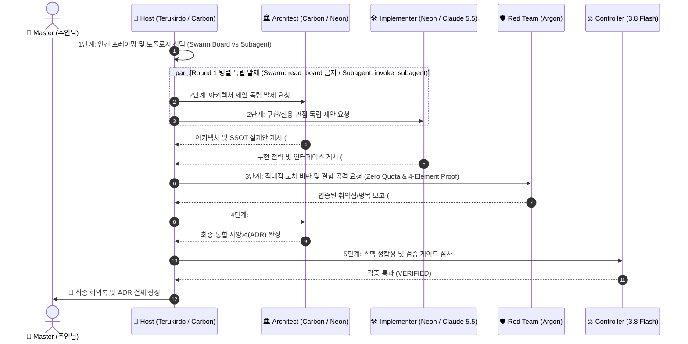

# Multi-Agent Conference & Roundtable (다자간 에이전트 원탁회의)

복잡한 시스템 설계, 프론트-백엔드 간 인터페이스 합의, 보안 및 성능 트레이드오프 분석 등 단일 모델의 판단만으로 불확실성이 큰 의사결정을 해결하기 위해 **특화된 복수 모델 페르소나 간의 구조화된 원탁회의(Roundtable Conference)**를 주재하고 합의된 아키텍처 결정서(ADR) 및 사양서를 도출하는 스킬이다.

---

## 1. Use When (발동 조건)

- 2개 이상의 아키텍처/기술적 대안 사이에서 명확한 트레이드오프 분석이 필요할 때.
- UI/UX, 백엔드 데이터 엔진, 보안 경계가 얽힌 대규모 기능의 공동 설계가 필요할 때 (`UltimateMake` Phase 3 포함).
- 단일 모델의 인지 편향(Cognitive Bias)이나 맹점을 타파하기 위해 **적대적 레드팀 검증(Adversarial Red Teaming)**이 필요할 때.
- 사용자(주인님)가 다자간 회의, 브레인스토밍, 모델 간 토론을 명시적으로 요청했을 때.

---

## 2. Participant Personas & Role Matrix (v5.8 × CLI v1.5.16 27-Slug Ecosystem 참여 모델 및 역할 체계)

회의는 문제의 성격과 호출 컨텍스트에 따라 테르키르도 v5.8 × Antigravity CLI `v1.5.16` (`v1.5.12` 서버 측 Wire Tier 베이스라인) 비대칭 멀티 엔진 페르소나 중 2~5인을 선별하여 구성한다:
- **Mode A — Native `swarm` Zero-Copy Board Mode** (명시적 `/swarm` 슬래시 명령 또는 인가된 `UltimateMake` Phase 3 세션): `architect`, `implementer`, `red-team`, `ux-lead`, `qa-lead` 페르소나를 스웜 보드에 직접 스폰하며(`narrator`/`monitor` 오버헤드 워커 `0`명), 27슬러그 카탈로그(`gemini-4-carbon-high`, `gemini-4-neon-xhigh`, `gemini-pro-orchestrator-neon`, `gemini-4-argon-high`, `gemini-3.8-flash-high`, `claude-opus-5-5-high`, `claude-sonnet-5-5-high`, `gpt-oss-120b-medium` 등)로 페르소나별 모델을 개별 핀닝하거나 세션 모델을 균일 적용할 수 있다.
  - **Optional 8-Seat Grand Council Extension (Hermes Guest Bridge)**: Mode A 확장 시 `swarm(action="add")`로 브리지 워커를 스폰하기 **전**에 반드시 `python -X utf8 scripts/hermes_guest.py --preflight --seats deepseek qwen gpt`를 실행해 병렬 가용성·쿼터를 사전 점검하고, `ready`로 통과한 좌석에 한해 `gemini-4-hydrogen-low` 브리지 워커(`guest-deepseek` [`alibaba-coding-plan:deepseek-v4.1-flash`], `guest-qwen` [`alibaba-coding-plan:qwen4-max`], `guest-gpt` [`openai-codex:gpt-6-sol`])를 착석시킨다(`evicted` 좌석은 스폰 없이 자동 퇴출하고 1줄 보고). 각 브리지 워커는 `python -X utf8 scripts/hermes_guest.py --seat <deepseek|qwen|gpt> --session um-<slug>-<seat> --prompt-file <file>`로 외부 모델을 호출해 Round 2~3 세션 연속성을 유지하며 원문 그대로 게시하고, 중도 `exit code 2` 시 `[guest-unavailable]` 보고 후 즉시 `swarm(action="kill", name="guest-<seat>")`로 퇴출한다. 회의 종료 시 잔존 전원 `swarm(action="kill")`으로 완전 해체한다 (`0` active workers).
  - **Native Swarm Quota Hot-Swap Fallback (`swarm` `action="model"`)**: 핀닝된 네이티브 페르소나(`claude-opus-5-5-high`, `claude-sonnet-5-5-high`, `gpt-oss-120b-medium` 등)가 쿼터/용량 한계에 도달하면 워커를 종료하지 않고 `swarm(action="model", name="<worker>", model="gemini-4-carbon-high")` (또는 `gemini-4-neon-xhigh`)로 즉시 핫스왑하여 대화 컨텍스트를 보존한 채 회의를 속행한다.
- **Mode B — Standard `invoke_subagent` + `send_message` Handle Reuse Mode** (일반 대화형 원탁회의 요청 또는 `UltimateMake` 저쿼터 폴백): `.agents/hooks/pre_tool_use_policy.py`가 비슬래시 일반 대화의 `swarm` 호출을 차단하므로, 일반 대화에서는 `invoke_subagent`(`inherit`: `Gemini 4 Carbon` / `Gemini 4 Neon` / `Orchestrator [gemini-pro-orchestrator / gemini-pro-orchestrator-neon / gemini-pro-orchestrator-argon]` / `Gemini 4 Hydrogen [High/XHigh]` / `Claude 5.5 · GPT-OSS 120B` × `pro`: `Gemini 4 Argon` × `flash`: `Gemini 3.8 Flash`) 및 `send_message` 핸들 재사용으로 운용한다.

| 역할 | 페르소나 모델 (Subagent Tier / Optional Swarm Slug) | 주요 전문 영역 및 책임 |
| :--- | :--- | :--- |
| 👑 **주재관 (Host / Moderator)** | **테르키르도 (Terukirdo Orchestrator — Gemini 4 Carbon / Neon / Orchestrator / Hydrogen / Claude 5.5, `inherit`)** | 안건 상정, 발언권 조율, 논점 이탈 방지, 갈등 중재, 최종 합의안/ADR 종합 작성 및 스웜 `kill` 정리 |
| 🏛️ **수석 아키텍트 (`architect`)** | **Gemini 4 Carbon / Gemini 4 Neon / Orchestrator (`inherit` 또는 `gemini-4-carbon-high` · `claude-opus-5-5-high`)** | 거시적 시스템 구조, 도메인 경계, 인터페이스(SSOT), 데이터 흐름, ADR 초안 설계 |
| 🛠️ **실행/구현 엔지니어 (`implementer`)** | **Gemini 4 Neon (High/XHigh) / Gemini 4 Carbon / Gemini 4 Hydrogen (High/XHigh) (`inherit` 또는 `gemini-4-neon-xhigh` · `claude-sonnet-5-5-high`)** | 코드 수준 구현 가능성, 고속 프로토타이핑 검증, 프로젝트 언어/아키텍처 관례 준수, 리팩터링 정밀도 |
| 🛡️ **적대적 심판관 / 레드팀 (`red-team`)** | **Gemini 4 Argon (`pro`, Wire `gemini-4-hydrogen-tiered-xhigh` 또는 `gemini-4-argon-high` · `gpt-oss-120b-medium`)** | 침투 테스트 관점 공격, 보안 취약점, 경쟁 상태(Race Condition), 락프리 동시성·성능 병목 적발 |
| 🎨 **UX/UI & 접근성 리드 (`ux-lead`)** | **Gemini 4 Carbon / Neon / Hydrogen / Argon** | 사용자 여정, 화면 흐름, 로딩/빈/에러 상태, 접근성(WCAG) 및 디자인 시스템 정합성 검토 |
| 🧪 **QA & 검증 전략가 (`qa-lead`)** | **Gemini 4 Argon / Gemini 3.8 Flash** | Given-When-Then 인수조건, 회귀 테스트 경계, 엣지 케이스 검증 매트릭스 및 물리 게이트(`verify.ps1`, 단위 테스트) 설계 |
| ⚖️ **최종 관제 게이트키퍼 (Universal Controller)** | **Gemini 3.8 Flash (`flash`, Wire `gemini-4-hydrogen-tiered-high`)** | 스펙 정합성, 빌드·테스트 게이트 및 규정 준수 신속 판정 |
| 🌐 **외부 게스트 3석 (`guest-deepseek` / `guest-qwen` / `guest-gpt`)** | **`gemini-4-hydrogen-low` + `scripts/hermes_guest.py` (`deepseek-v4.1-flash`, `qwen4-max`, `gpt-6-sol`)** | *(선택적 8-Seat Grand Council)* 알고리즘 효율·분산 상태 일관성·재현성 기반 비원자성 적대적 레드팀 검증 (Read-Only `-t ""` 샌드박스) |

---

## 3. Standard 5-Stage Conference Protocol (표준 5단계 회의 프로토콜)



### [Stage 1] 안건 및 제약조건 프레이밍 (Agenda Framing & Mode Selection)
- 해결하고자 하는 문제의 본질, 성공 기준, 불변의 전제 조건(하네스 격리, 성능 목표, 프로토콜 v5.8 준수 등)을 명문화한다.
- 활성 컨텍스트가 `/swarm` 또는 인가된 `UltimateMake` 세션이면 **Mode A (Native `swarm` Board)**를, 일반 대화 요청이나 저쿼터 모드이면 **Mode B (`invoke_subagent` + `send_message`)**를 선택한다.

### [Stage 2] 도메인별 독립 제안 발제 (Round 1: Anti-Anchoring Independent Proposals)
- **Mode A (`swarm` Board)**: 8-Seat Grand Council 확장 시 스폰 전 `python -X utf8 scripts/hermes_guest.py --preflight --seats deepseek qwen gpt`로 `ready` 좌석만 선별(`evicted` 좌석은 미스폰 퇴출)한 뒤, 페르소나 스폰(`action="add"`) 시 초기 브리프에 **"자신의 독립 1차 제안서를 `post_message`로 게시하기 전에는 절대로 `read_board`를 호출하지 말 것"**을 명시하여 앵커링 편향(Anchoring Bias)을 원천 차단한다.
- **Mode B (`invoke_subagent`)**: 병렬 `invoke_subagent` 스폰으로 각 전문가가 독립 제안서를 제출한다.

### [Stage 3] 적대적 교차 비판 및 결함 공격 (Round 2: `#seq` Cross-Critique & Red Teaming)
- 적대적 심판관(`Gemini 4 Argon` 등)이 제안서들의 보안 취약점, 경쟁 상태, 성능 병목, 도메인 경계 침범을 교차 검증한다.
- **Mode A (`swarm` Board)**: 참가자들이 `read_board`로 동료의 `#seq` 엔트리를 열람하고 번호를 직접 인용하여 반론·보완안을 게시한다. Round 2~3 중 게스트 브리지 워커가 `exit code 2`를 반환하면 `[guest-unavailable]` 보고 후 즉시 `swarm(action="kill", name="guest-<seat>")`로 퇴출하고, 네이티브 핀닝 워커(`claude-opus-5-5-high` 등)의 쿼터 한계 시 `swarm(action="model", name="<worker>", model="gemini-4-carbon-high")` (또는 `gemini-4-neon-xhigh`)로 핫스왑하여 컨텍스트를 유지한다.
- **Mode B (`invoke_subagent`)**: 중복 서브에이전트를 새로 스폰하지 않고 기존 `conversationId`에 `send_message(Recipient=conv_id, Message=...)`를 호출하여 핸들과 컨텍스트를 재사용한다.

### [Stage 4] 갈등 중재, 통합 합의안(ADR) 도출 및 스웜 해체 (Round 3: Consensus, ADR Synthesis & Swarm Teardown)
- 주재관(테르키르도) 및 수석 아키텍트(`read_board` 수합 또는 `send_message` 핸들 재사용)가 입증된 지적사항과 각 의견의 합리적 요소를 융합하여 단일 진실 공급원(SSOT) 아키텍처 결정서(ADR)를 작성한다.
- **Swarm Clean Teardown 불변식**: Mode A(`swarm`)를 사용한 경우, ADR 초안 도출 직후 반드시 스폰한 모든 회의 워커에 대해 `swarm`(`action="kill"`)을 실행하여 활성 스웜 워커 `0`명 상태를 확인한 뒤 다음 단계(`validate_spec_lock.py` 또는 주인님 보고)로 전진한다.

### [Stage 5] 주인님 결재 상정 및 실행 위임 (Stage 5: Master Review & Actionable Handoff)
- 최종 회의록 및 ADR 문서를 아티팩트로 렌더링하여 주인님께 보고하고 명시적 승인을 구한다.
- **실행 이관 경로**:
  - **일반/단일 범위**: 표준 `Ralph Loop` (`implement-feature` / `agy-worker`)로 이관하여 구현 착수.
  - **대규모 비충돌 다중 모듈**: 주인님이 `/agent-legion` 슬래시 명령을 명시적으로 승인·발동할 경우 **Octa-Ralph(`MAX_CONCURRENT_RALPH = 8`)** 배타적 파티션 분해 및 `.agents/skills/agent-legion/scripts/legion_radio.py` 공용 무전 게시판 초기 `INTERFACE`/`SCHEMA` 규격 시딩으로 이관 가능하다.

---

## 4. Operating Rules & v5.8 Conference Contract (운영 원칙 및 v5.8 회의 규약)

1. **Anti-Echo Chamber & Round 1 Anti-Anchoring**: 모든 주요 회의에는 최소 1개 이상의 적대적 비판자(`Gemini 4 Argon` 등)를 필수 배치하며, 스웜 보드 운용 시 Round 1 초기 게시 전 `read_board` 호출을 금지한다.
2. **Subagent Handle Reuse & Swarm Clean Teardown**: Mode B에서는 Round 2~3 교차 반론 시 기존 `conversationId`에 `send_message(Recipient=conv_id, Message=...)`를 호출하여 핸들을 재사용하고, Mode A(`swarm`)에서는 `narrator`/`monitor` 없이 핵심 페르소나만 가동한 뒤 회의 종료 즉시 전원 `swarm`(`action="kill"`)로 정리한다.
3. **Zero Finding Quota & 4-Element Defect Contract (결함 할당량 없음 및 4요소 입증 계약)**: 적대적 레드팀 발언에는 의무적 결함 발굴 할당량이 없으며(Zero Finding Quota), 설계가 안전하고 완전하면 이를 인정하는 것이 성공이다. 설계 변경이나 블로킹 수정을 요구하는 중대 결함 제기 시에는 반드시 **(1) 위반된 계약/요구사항 + (2) 구체적 트리거 시나리오 + (3) 현재 코드/설계 근거 + (4) 실질적 피해/영향**의 4요소를 입증해야 한다.
4. **Evidence-Based Arguments (증거 기반 주장)**: 모든 찬반 의견은 막연한 주관이 아닌 구체적인 코드/설계 근거, 벤치마크 수치, 기술 스펙, 보안 표준을 근거로 제시해야 한다.
5. **Bounded Iteration (라운드 상한)**: 토론이 무한 루프에 빠지지 않도록 최대 3라운드 이내에 주재관이 합의안을 종합하며, 해결되지 않는 가치 판단은 주인님께 옵션별 득실로 에스컬레이션한다.
6. **Domain Boundary Preservation**: 회의 산출물은 반드시 개발 하네스(`.agents/`)와 대상 프로젝트 런타임 소스 코드 간의 도메인 경계를 엄격히 준수해야 한다.
7. **Master Sovereignty (주인님 주권)**: 최종 설계 확정 및 아키텍처 변경 권한은 오직 주인님의 승인에 귀속된다.

---

## 5. Output Artifacts (산출물 형식)

회의 종료 시 다음 구조의 마크다운 아티팩트를 생성한다.

```markdown
# 🏛️ [Conference Minutes & ADR] <안건명>

- **일시**: <Timestamp>
- **주재관**: 테르키르도 (Terukirdo Orchestrator — Gemini 4 Carbon / inherit)
- **참석 페르소나**: <참여 Tri-Engine 모델 및 역할 목록>

## 1. 안건 및 핵심 쟁점 (Agenda & Core Dilemma)
## 2. 페르소나별 핵심 입장 및 논거 (Proposals by Persona)
## 3. 적대적 레드팀 검증 및 보완책 (Adversarial Red Team Findings [4-Element Proof] & Remediations)
## 4. 최종 합의 아키텍처 결정서 (Consensus ADR)
   - Status: Proposed / Approved
   - Context: <배경>
   - Decision: <확정 결정>
   - Consequences: <긍정적/부정적 파급 효과>
## 5. 다음 실행 계획 및 태스크 분해 (Actionable Handoff)
   - 단일/일반 범위: 표준 Ralph Loop (`implement-feature` / `agy-worker`) Execution Card 이관
   - 대규모 다중 모듈 (주인님 `/agent-legion` 명시적 승인·발동 시): Octa-Ralph (`MAX_CONCURRENT_RALPH = 8`) 비충돌 파티션 분해 및 `.agents/skills/agent-legion/scripts/legion_radio.py` 초기 `INTERFACE`/`SCHEMA` 무전 시딩 계획
```
